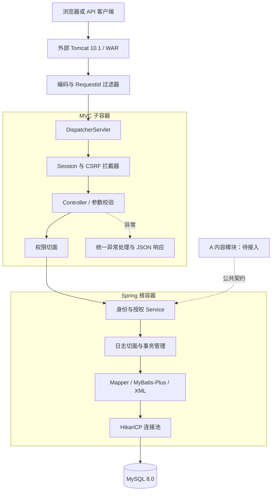
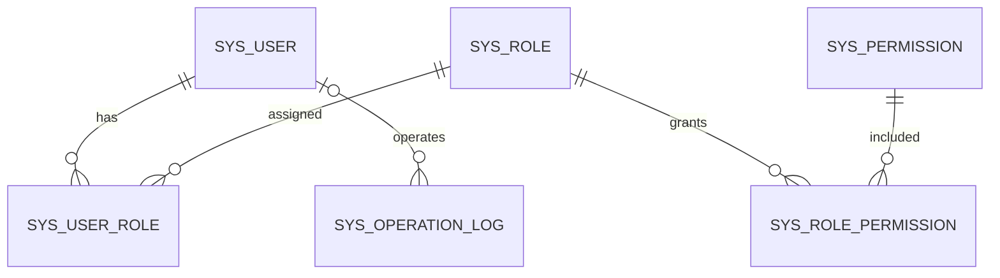
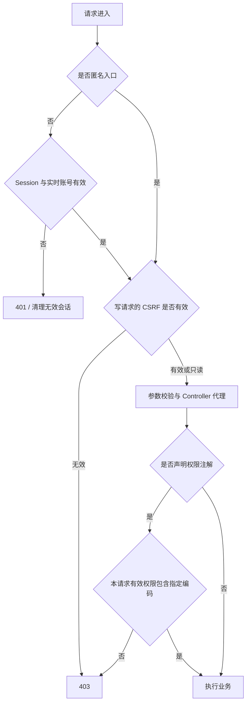
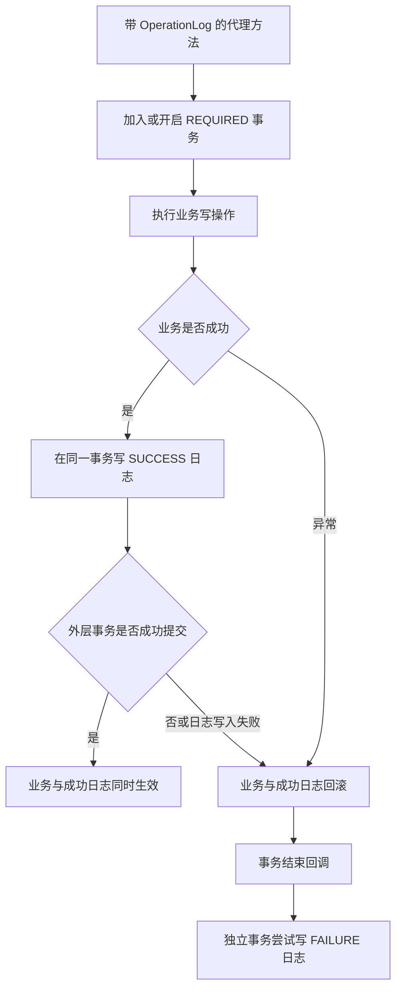
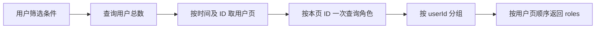

# B 模块架构与流程图

更新：2026-10-12。对应传统 SSM 代码基线 `8872274`，生产逻辑与 `447904c` 相同。本文描述 B 已实现的后端；A 的分类、文章、审核和发布仍待接入验收。

## 1 分层与容器

图中表示主要调用责任，不表示每个只读 Service 都经过日志切面。日志仅作用于带 `@OperationLog` 的代理方法。统一异常处理也接收向 MVC 传播的业务异常。

- `CmsWebInitializer` 启动根容器与 MVC 子容器，不依赖 Spring Boot。
- `RootConfiguration` 扫描业务与安全组件，排除 Controller、Advice 和配置类，导入持久层与日志能力。
- `WebConfiguration` 只扫描 Controller/Advice，显式导入 Session、CSRF 和权限切面。Controller 不能在父子容器重复创建。
- `PersistenceConfiguration` 统一注册数据源、事务、Mapper、XML 和 MyBatis-Plus 插件；A 接入时复用这些基础设施。
- Java 17 编译，外部 Tomcat 部署 `enterprise-cms.war`。测试专用 H2、JUnit、内嵌 Tomcat 不进入 WAR。

## 2 B 数据关系

这是 B 六张表的核心关系简图。完整字段、主键、唯一约束、审计外键与索引见[数据库设计](B模块数据库设计.md)，最终建表依据为 `sql/001_identity_schema.sql`。日志允许匿名操作者，目标由类型与 ID 描述，不给多种业务对象共用的目标 ID 设置单表外键。用户、角色和权限使用逻辑删除；关系撤销删除关系记录，日志只追加。

A 的文章、分类和状态历史未放入这张已实现关系图；两方全项目 ER 图需在 A 的内容 SQL 验证后合并。

## 3 登录与请求权限流程

公开写接口仍校验 CSRF。登录顺序为获取 CSRF → 提交账号密码 → 成功后更换 Session ID 与 CSRF → 获取新令牌 → 进行后续写操作。密码使用带随机盐的 PBKDF2-SHA256 摘要，接口不返回摘要。

`CurrentUserContext` 在当前请求内保存不可变快照；后续请求重新读取有效账号、角色和权限，因此撤权无需用户重新登录。管理写操作在事务内取得统一锁后再检查权限，避免只依赖请求开始时的状态。`ADMIN` 角色没有跳过权限检查的特殊通道。

**入口约束：** 需要细粒度权限的公开 Controller 方法必须声明 `@RequirePermission`。未声明注解不会自动产生权限限制，接入时要逐项检查。Spring 代理不能拦截同一对象的 `this.method()`；不能只给内部被调用方法加注解。详见[B14 接入说明](../api/B14权限注解接入.md)及其内部调用风险测试。

## 4 数据库写操作的日志与事务

成功日志写入要求已有事务，失败则业务不能提交；外层回滚时成功日志也回滚。失败日志使用独立事务，写入故障记录到应用日志且不掩盖原业务异常。目标只解析受限的 ID 表达式，不序列化整个请求、密码、Cookie 或 CSRF。

登录/退出改变的是 Servlet Session，不能与数据库提交构成同一事务；对应日志采取独立尽力记录。这一边界不能描述成“所有操作都能随日志失败完全回滚”。详见[B15 事务说明](../api/B15操作日志接入.md)。

## 5 用户分页与角色组装

非空页固定 3 次 SQL；空结果或超出末页时只查询总数。三个查询在一个只读 REPEATABLE_READ 事务中执行。分页对象是用户，避免一人多角色的连接结果破坏分页边界。管理展示保留停用角色、排除已删除角色；展示数组不能用作有效授权判断。测量范围、测试对照和 MyBatis-Plus 使用位置见[B17 优化证据](../optimization/B用户角色查询优化.md)。
